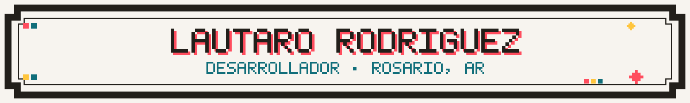
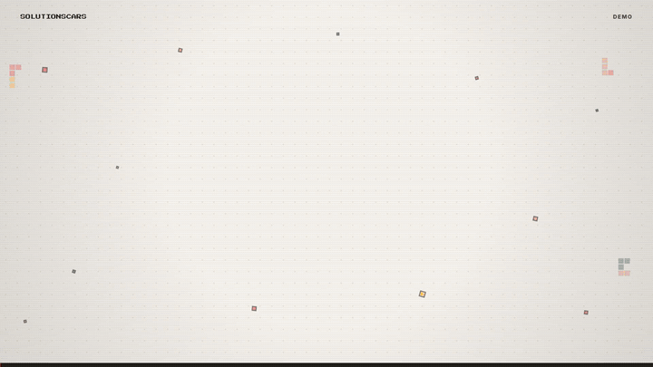

  

  Python, React y automatización. Hago software que se usa todos los días en negocios reales.

  
  

  

  
  
  
  
  
  
  
  
  

  

  

  <strong>SolutionsCars</strong>
  &nbsp;
  

  Sistema de gestión para un taller de GNC: recepción de vehículos, vencimientos, inventario, facturación electrónica con ARCA y reportes. Hoy lo usa el taller todos los días.

  Python · Flet · SQLAlchemy · PostgreSQL · Alembic
   
  Repo privado (cliente real). Demo con datos de ejemplo.

  

  

  <picture>
    <source media="(prefers-color-scheme: dark)" srcset="https://raw.githubusercontent.com/Rahyned/Rahyned/output/snake-dark.svg" />
    <source media="(prefers-color-scheme: light)" srcset="https://raw.githubusercontent.com/Rahyned/Rahyned/output/snake-light.svg" />
    
  </picture>

