  

  Arranco <strong>Ciencia de Datos</strong> en la UNR en 2027. Llegué a programar por los videojuegos.

  
  

  

  <picture>
    <source media="(prefers-color-scheme: dark)" srcset="https://skillicons.dev/icons?i=py,react,js,html,css,git,github,vercel,postgres&theme=dark&perline=9" />
    <source media="(prefers-color-scheme: light)" srcset="https://skillicons.dev/icons?i=py,react,js,html,css,git,github,vercel,postgres&theme=light&perline=9" />
    
  </picture>

  

  

  

  <picture>
    <source media="(prefers-color-scheme: dark)" srcset="https://raw.githubusercontent.com/Rahyned/Rahyned/output/snake-dark.svg" />
    <source media="(prefers-color-scheme: light)" srcset="https://raw.githubusercontent.com/Rahyned/Rahyned/output/snake-light.svg" />
    
  </picture>

